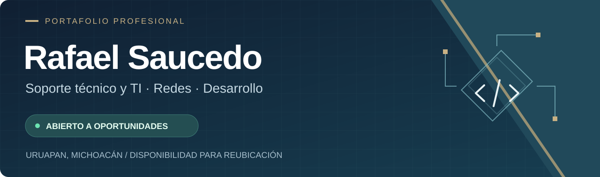
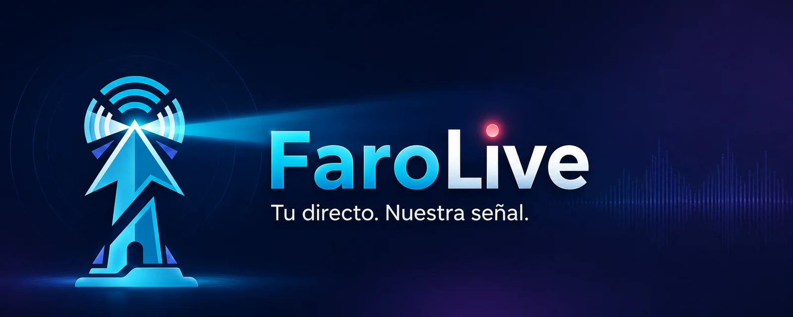
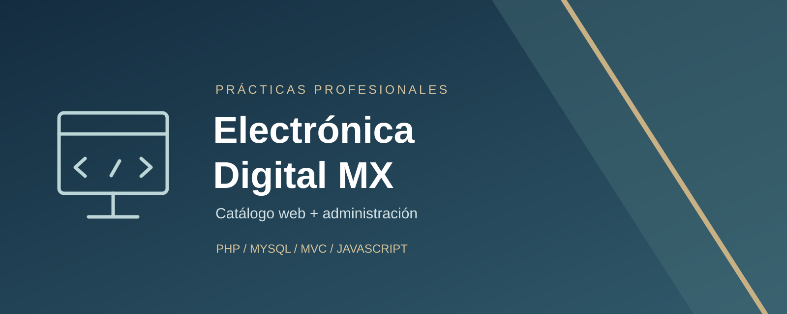

  

  
  &nbsp;
  

CV profesional · Soporte y TI, redes, desarrollo web y móvil, y bases de datos · PDF de 1 página

  <a href="mailto:sabr030223@itsuruapan.edu.mx"><b>CONTACTO PROFESIONAL</b></a>
  &nbsp; / &nbsp;
  <a href="https://github.com/RafaelSaucedo2302/FaroLive-Showcase"><b>CONOCER FAROLIVE</b></a>
  &nbsp; / &nbsp;
  <a href="https://rafaelsaucedo2302.github.io/FaroLive-Manual/"><b>DOCUMENTACIÓN</b></a>

## Hola, soy Rafael

Soy egresado de **Ingeniería en Sistemas Computacionales** del Instituto Tecnológico Superior de Uruapan. Combino la atención a usuarios y el diagnóstico de equipos con el desarrollo de aplicaciones, bases de datos e integraciones.

Busco incorporarme a un equipo de **soporte técnico, TI o desarrollo de software**. Vivo en **Uruapan, Michoacán**, y tengo **disponibilidad para cambiar de residencia** por motivos laborales. Mis residencias profesionales están concluidas y mi proceso de titulación está en curso.

 

<table>
  <tr>
    <td width="50%" valign="top">
      
      <h3>Soporte y TI</h3>
      
Diagnóstico de hardware y software, mantenimiento de equipos y configuración de Windows, aplicaciones y periféricos.

      
<b>Atención a usuarios</b> Apoyo presencial y remoto, seguimiento de incidencias, respaldos y documentación.

    </td>
    <td width="50%" valign="top">
      
      <h3>Redes</h3>
      
Configuración básica de routers y switches, fundamentos de LAN/WAN y TCP/IP.

      
<b>Conectividad</b> Diagnóstico básico de problemas de conexión y configuración de equipos.

    </td>
  </tr>
  <tr>
    <td width="50%" valign="top">
      
      <h3>Desarrollo web y móvil</h3>
      
Java, Kotlin, Python, PHP, JavaScript y TypeScript. Aplicaciones con React Native, Node.js y Express; interfaces con HTML5, CSS3 y EJS.

      
<b>Aplicaciones e integraciones</b> APIs REST, MVC, componentes reutilizables, autenticación, OAuth2 y automatización para Discord.

    </td>
    <td width="50%" valign="top">
      
      <h3>Bases de datos</h3>
      
Integración de MySQL, SQLite, MongoDB y Firebase en proyectos web, móviles y de automatización.

      
<b>Integridad y validación</b> Relaciones entre datos, integridad referencial, consultas parametrizadas, validaciones en múltiples capas y prevención de duplicados.

    </td>
  </tr>
</table>

 

## Proyectos que representan mi trabajo

<table>
  <tr>
    <td width="50%" valign="top">
      
      <h3>01 · FaroLive</h3>
      
<b>Proyecto propio · 2026</b>

      
Bot multiservidor de Discord y panel web para centralizar anuncios de transmisiones, perfiles públicos y administración de comunidades.

      <ul>
        <li>Detección automática en Twitch, YouTube y Kick.</li>
        <li>Flujos guiados para TikTok.</li>
        <li>OAuth2, permisos por roles y auditoría.</li>
        <li>Perfiles públicos de creadores y documentación de uso.</li>
      </ul>
      
<code>TypeScript</code> <code>Node.js</code> <code>Express</code> <code>EJS</code> <code>discord.js</code> <code>SQLite</code>

      
<a href="https://github.com/RafaelSaucedo2302/FaroLive-Showcase"><b>Explorar proyecto ↗</b></a> <a href="https://panel.farolive.xyz">Panel web</a> · <a href="https://rafaelsaucedo2302.github.io/FaroLive-Manual/">Manual</a>

    </td>
    <td width="50%" valign="top">
      
      <h3>02 · Electrónica Digital MX</h3>
      
<b>Desarrollador web · Prácticas profesionales</b> Febrero de 2026 - Agosto de 2026

      
Sitio web para una empresa de electrónica, con catálogo de productos y herramientas para administrar su información y solicitudes.

      <ul>
        <li>Búsqueda, filtros y fichas de producto.</li>
        <li>Gestión de productos, categorías y usuarios.</li>
        <li>Autenticación y roles de acceso.</li>
        <li>Seguimiento de solicitudes y consultas parametrizadas.</li>
      </ul>
      
<code>PHP</code> <code>MySQL</code> <code>PDO</code> <code>MVC</code> <code>JavaScript</code> <code>HTML / CSS</code>

      
<b>Experiencia aplicada a una empresa</b> Desarrollo del catálogo y de su panel administrativo.

    </td>
  </tr>
</table>

El código fuente de FaroLive es privado. Su presentación, recursos de marca y manual se pueden consultar en los enlaces públicos.

 

### Más proyectos

| Proyecto | Qué desarrollé | Tecnologías |
| :--- | :--- | :--- |
| **[Web Gestion TEC ↗](https://github.com/CarlosGonzalez7u7/Web-Gestion-TEC)** | Colaboración en gestión académica: frontend, búsquedas, paginación y validaciones. | `PHP` `MySQL` `JavaScript` `API REST` |
| **SnapMath** | Funciones móviles para clases, tareas y anuncios. | `React Native` `TypeScript` `APIs REST` |
| **Killstore Feedback Bot** | Reseñas, validación de pedidos e integración de servicios externos. | `Python` `Discord.py` `SQLite` |

<b>Ver aportaciones técnicas por proyecto</b>

#### Web Gestion TEC

- Colaboré en la arquitectura MVC con PHP y una API REST para autenticación, docentes, requisitos, semestres y bitácoras.
- Implementé funciones de frontend con HTML5, CSS3 y JavaScript (Fetch API), búsqueda, paginación y matrices interactivas.
- Trabajé con MySQL, relaciones, integridad referencial, consultas parametrizadas y validaciones en múltiples capas.

#### SnapMath

- Participé en el desarrollo móvil con React Native y TypeScript: navegación, autenticación, clases, tareas y anuncios para estudiantes y profesores.
- Implementé asistencia académica con IA para Matemáticas, Física y Química, con fórmulas y recursos educativos.
- Integré APIs REST para sincronizar datos y desarrollé componentes y contextos reutilizables para gestionar autenticación, navegación y estado.

#### Killstore Feedback Bot

- Creé formularios interactivos de Discord para capturar número de pedido, calificación y comentarios con validaciones.
- Integré PrestaShop para verificar pedidos y pagos, Imgur para imágenes y un sistema de lealtad para gestionar créditos.
- Utilicé SQLite para almacenar reseñas y prevenir duplicados; implementé mensajes interactivos, logging, manejo de errores, timeouts y validaciones de seguridad.

 

## Tecnologías, herramientas y formación

| Área | Herramientas y conocimientos |
| :--- | :--- |
| **Soporte y productividad** | Windows · Word · Excel · PowerPoint |
| **Lenguajes** | Java · Kotlin · Python · PHP · JavaScript · TypeScript |
| **Web y móvil** | React Native · Node.js · Express · EJS · HTML5 · CSS3 |
| **Bases de datos** | MySQL · SQLite · MongoDB · Firebase |
| **Prácticas de desarrollo** | APIs REST · MVC · Componentes reutilizables · OAuth2 · Validación de datos |
| **Prácticas con datos** | Integridad referencial · Consultas parametrizadas · Prevención de duplicados |
| **Herramientas de trabajo** | Git · GitHub · Android Studio · Apache · Discord |

**Ingeniería en Sistemas Computacionales** · Instituto Tecnológico Superior de Uruapan · 2021 - 2026 
Egresado, con residencias profesionales concluidas y proceso de titulación en curso.

**Formación previa:** CECyTEM · Área Físico Matemática.

**Español:** nativo &nbsp; / &nbsp; **Inglés:** intermedio técnico.

**Competencias:** resolución de problemas, comunicación con usuarios, trabajo en equipo, organización y seguimiento, adaptación tecnológica y tolerancia al estrés.

---

  <b>Disponible para oportunidades de soporte técnico, TI y desarrollo.</b> 
  Uruapan, Michoacán · Disponibilidad para reubicación  
  <a href="mailto:sabr030223@itsuruapan.edu.mx"><b>Hablemos de tu vacante →</b></a>
  &nbsp; / &nbsp;
  <a href="https://github.com/RafaelSaucedo2302/RafaelSaucedo2302/blob/main/cv/CV_Rafael_Saucedo.pdf"><b>Ver mi CV</b></a>
  &nbsp; / &nbsp;
  <a href="https://github.com/RafaelSaucedo2302/RafaelSaucedo2302/raw/refs/heads/main/cv/CV_Rafael_Saucedo.pdf"><b>Descargar PDF ↓</b></a>

